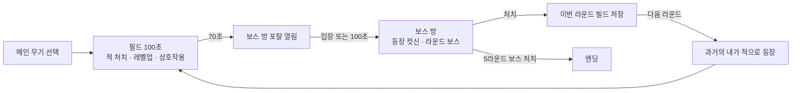

# 100초 군단 기획서

## 1. 한 줄 컨셉

100초마다 내가 키운 빌드가 다음 라운드에 적이 되어 돌아오는 뱀서라이크.

## 2. 핵심 재미 가설

시작은 "일반 뱀서라이크와 무엇으로 차별화할까"라는 질문이었다.

뱀서라이크의 재미는 단순하다. 적을 많이 잡아 레벨업을 많이 하고, 강해진 힘으로 더 많은 적을 쓸어버리는 쾌감이다.

여기에 **과거의 내 빌드가 그대로 적으로 나온다**는 규칙을 더하면 두 가지가 달라질 거라고 봤다.

- **더 어려워지고, 그래서 더 재밌다.** 내가 강해진 만큼 다음 라운드의 적도 강해진다.
- **생각할 거리가 하나 더 생긴다.** 레벨업을 고를 때 "지금 나에게 좋은가"와 함께 "다음 라운드에 이걸 상대해야 한다"를 같이 따지게 된다.

## 3. 코어 루프

- 한 판은 5라운드이고, 라운드마다 100초다.
- 70초에 보스 방 포탈이 열린다. 들어가거나 100초가 되면 별도의 좁은 보스 방으로 이동한다.
- 라운드가 끝나면 그 시점의 빌드(무기, 특성, 레벨)가 저장된다. 다음 라운드부터 그 빌드를 쓰는 **과거의 나**가 적으로 나온다.

## 4. 시스템 요약

수치는 모두 [`legion/data/balance.json`](../legion/data/balance.json)에 있다. 이 문서에는 구조만 적는다.

| 시스템 | 내용 |
|---|---|
| 메인 무기 4종 | 마력탄(원거리 탄환), 가시 오라(근접 지속 피해), 낙뢰(무작위 광역), 시간의 실(지나간 자리에 남는 실, 고리를 닫으면 안쪽이 폭발). 5레벨에 각성하면 성질이 크게 바뀐다. |
| 시간의 실 | 조준 없이 움직임으로 공격하는 고유 무기. 걸어온 자리에 실이 남아 닿는 적을 베고, 실 끝이 실에 다시 닿아 고리가 닫히면 안쪽과 고리에 걸친 적이 터진다. 과거의 나는 내 경로를 그대로 걷기 때문에, 내가 그린 고리가 다음 라운드에 예고된 함정으로 돌아온다. |
| 특성과 강화 | 무기마다 전용 특성 3종이 있고, 공통 강화(힘, 가속, 활력)가 있다. |
| 과거의 나 | 저장된 빌드를 그대로 쓴다. 무기에 따라 행동이 다르다: 탄막형(거리 유지), 돌격형(접근), 포격형(멀리서 낙뢰), 매듭형(주위를 돌며 실로 가둠). |
| 웨이브 | 포위, 돌격, 협공, 정예 편성이 정해진 시각에 몰려온다. |
| 보스 5종 | 거미 여왕(감속 거미줄), 망령(순간이동 탄막), 외눈 거인(내리찍기, 바위), 타락한 기사(돌진, 칼 휘두르기), 군단장(화염, 운석). 라운드마다 다른 보스가 나온다. |
| 상호작용 | 골드로 여는 보물상자, 도박형 미믹 룰렛, 체력을 바치는 피의 제단. 1회성 레벨업이나 버프를 준다. |
| 궁극기 | 적 80마리를 잡으면 충전된다. 무기별로 화면을 쓸어버리는 연출이 다르다. |

## 5. 역할 분담

| 누가 | 하는 일 |
|---|---|
| 사람 | 문제를 정의하고, 직접 플레이해서 재미를 판단하고, 최종 결정을 내린다. |
| AI | 데이터와 구현 초안을 쓰고, 수치 조정안을 제안한다. |
| 봇 | 같은 규칙(`legion/sim/`)으로 수백 판을 돌려 밸런스를 측정한다. 재미는 판단하지 않는다. |

게임 규칙은 `legion/sim/`에만 있다. 화면과 봇이 같은 규칙을 쓰기 때문에 봇의 측정값을 실제 게임에 그대로 적용할 수 있다.

**사례: 봇과 사람의 판단이 갈린 가시 오라**
- 봇 측정에서는 오라 특화 승률이 가장 낮았다.
- 사람이 플레이해 보니 오라가 가장 깨기 쉬웠다.
- 봇이 근접 무기를 서툴게 다룬다고 보고, 수치는 바꾸지 않고 기록만 남겼다.
- 자세한 내용은 [`playtest/ai_log.md`](../playtest/ai_log.md)에 있다.

## 6. 내린 결정과 이유

직접 플레이하며 느낀 문제와 그에 따라 내린 결정을 시간 순서로 적었다. 결정 방식은 두 가지로 나뉜다.
- **사람 제안:** 내가 먼저 꺼낸 아이디어.
- **사람 선택:** AI가 낸 선택지 중에서 내가 고른 것.

수치 결과는 [`playtest/ai_log.md`](../playtest/ai_log.md)에 있다.

### 방향 정하기 (11/07)

| 결정 | 방식 | 이유 |
|---|---|---|
| 수치는 데이터로 분리한다. AI가 밸런스 초안을 쓰고, 봇이 테스트한다. | 사람 제안 | 수치를 바꿀 때마다 봇 결과로 바로 확인할 수 있다. |
| AI가 분석한 후보 게임 중 100초 군단을 고른다. | 사람 선택 | |
| 포획 덱을 접고 100초 군단에 집중한다. | 사람 제안 | 재미가 덜했고, 직관적이지 않았다. |

### 핵심 재미 다듬기 (11/07)

| 직접 플레이하며 느낀 문제 | 결정 | 방식 |
|---|---|---|
| 보스가 없어 라운드에 절정이 없다. 과거의 나를 너무 쉽게 잡아서, 레벨업 때 다음 라운드를 생각하지 않고 강해지려고만 했다. | 라운드 후반에 전용 보스(군단장)를 내고, 과거의 나도 함께 몰려나오게 한다. 과거의 나는 더 단단하게 만든다. | 보스: 사람 선택. 과거의 나 강화: 사람 제안 |
| 위협적이지만 고르는 폭이 좁다. 레벨업이 덜 되는 느낌이다. | 처음에 메인 무기를 고르고 그 무기 위주로 선택지가 나오게 한다. 5레벨을 채우면 각성한다. 자석과 포션이 맵에 떨어진다. | 사람 제안 |
| 깨기 어려워서 좋지만 단조롭다. | 웨이브와 잡몹을 추가한다. AI는 이미 어렵다는 점을 고려해 위협보다 쓸어버리는 재미를 늘리는 쪽을 택했다. | 사람 제안 |
| 그래픽의 결을 정해야 더 재밌을 것 같다. | 컨셉은 게임성을 더 다듬은 뒤에 정한다. | 사람 제안 |

### 쾌감과 연출 (11/08)

| 직접 플레이하며 느낀 문제 | 결정 | 방식 |
|---|---|---|
| 중간중간 적을 쓸어버리는 순간이 없다. | 궁극기를 넣는다. 처치 수로 충전하고, 메인 무기마다 다른 3종을 만든다. 과거의 나는 궁극기를 쓰지 않는다. | 아이디어: 사람 제안. 세부: 사람 선택 |
| 타격감이 부족하다. | 궁극기를 쓸 때 카메라 전환을 넣고, 시작과 끝에 시네마틱을 넣는다. | 사람 제안 |
| 그래픽이 중요하다. | 무료 CC0 픽셀 아트 팩(Kenney Tiny Dungeon)을 쓴다. | 사람 선택 |
| 캐릭터가 이동 방향을 보지 않는다. UI가 게임 감성과 맞지 않는다. | 좌우 이동에 따라 스프라이트를 뒤집는다. 픽셀 UI 팩과 한글 픽셀 폰트(갈무리)를 쓴다. | 사람 제안 |
| 소리가 없다. 보스 애니메이션이 부자연스럽다. 스킬 이펙트가 밋밋하다. | 효과음을 넣는다. 보스 동작을 손보고, 파티클 텍스처로 이펙트를 바꾼다. | 사람 제안 |

### 공간과 다양성 (11/08)

| 직접 플레이하며 느낀 문제 | 결정 | 방식 |
|---|---|---|
| 같은 보스가 매번 나와 신선하지 않다. | 라운드마다 다른 보스 5종을 내고, 보스가 나올 때 컷신을 넣는다. | 아이디어: 사람 제안. 고정 5종: 사람 선택 |
| 맵이 좁다. | 필드는 넓게 하고 보스 방은 따로 둔다. 보스 방은 지금처럼 좁은 공간에서 싸운다. 70초에 포탈이 열리고 100초에 강제로 들어간다. 이유는 보스 컷신을 넣을 수 있고, 공간이 나뉘면 더 몰입될 것 같아서다. | 아이디어: 사람 제안. 시점: 사람 선택 |
| 넓은 맵에 할 거리가 없다. | 보물상자, 카지노 같은 상호작용으로 1회용 아이템이나 레벨업을 준다. 대가는 새 재화인 금화다. 과거의 나에게는 레벨업으로 얻은 힘만 복사된다. | 아이디어: 사람 제안. 세부: 사람 선택 |
| 보스마다 개성이 없다. | 보스에 맞는 스킬을 넣는다. 거미 여왕은 넓은 범위를 느리게 하는 거미줄, 사람 보스는 칼 휘두르기. | 사람 제안 |
| 기사의 칼 휘두르기가 어색하다. | 머리 위에서 빠르게 내리긋는 연출로 바꾼다. | 사람 제안 |

### 봇 결과와 다르게 판단한 것 (11/08)

| 상황 | 결정 | 방식 |
|---|---|---|
| 봇은 가시 오라를 가장 약한 무기로 쟀다. 직접 해 보니 오라가 가장 깨기 쉬웠다. | 수치를 바꾸지 않고 "봇 측정이 실제와 다르다"고 기록만 남긴다. 무기 격차는 사람 플레이를 기준으로 판단한다. | 사람 제안 |

### 완성도 (11/08)

| 직접 플레이하며 느낀 문제 | 결정 | 방식 |
|---|---|---|
| 빌드했을 때 게임의 처음과 끝이 없다. | 전용 타이틀, 게임 방법, 엔딩 화면을 만든다. 설정에는 볼륨, 전체 화면, 화면 흔들림 끄기, 조작키 안내를 넣는다. | 아이디어: 사람 제안. 항목: 사람 선택 |
| 크레딧이 필요 없다. | 크레딧 화면을 뺀다. | 사람 제안 |
| 배경 음악이 없다. | 필드와 보스 방에 각각 1곡씩, CC0 곡을 넣는다. | 사람 선택 |
| 버튼에 반응이 없다. 게임 중에 내 빌드를 볼 수 없다. | 버튼 클릭 소리를 넣는다. Esc 일시정지 화면에서 빌드 레벨을 보여주고, 설정으로 들어갈 수 있게 한다. | 사람 제안 |
| 레벨업 화면이 떠 있을 때 보스 방에 들어가면 컷신이 안 보인다. | 레벨업 선택이 끝난 뒤에 컷신을 재생한다. | 버그 발견: 사람. 해결: AI |

### 고유 무기 (11/10)

| 직접 플레이하며 느낀 문제 | 결정 | 방식 |
|---|---|---|
| 양산형 뱀서라이크와 별반 다르지 않다. 남들과 차별화되는 나만의 무기가 필요하다. | 네 번째 메인 무기 "시간의 실"을 넣는다. 뱀서라이크의 유일한 조작인 이동이 곧 조준이 되고, "과거의 나가 내 경로를 걷는다"는 이 게임의 규칙과 맞물려 내가 그린 고리가 적의 함정으로 돌아온다. | 문제: 사람 제안. 무기 컨셉과 구현: AI 제안. 채택 여부는 사람이 플레이해서 정한다. |

### 첫 외부 플레이테스트 (11/10)

v0.9.1을 다른 사람에게 플레이하게 하고 받은 피드백으로 정했다.

| 플레이테스터 피드백 | 결정 | 이유 |
|---|---|---|
| 너무 쉽다. | 과거의 나의 피해를 두 배로 올리고(0.45 → 0.9), 생존형 봇의 목표 승률을 30~50%에서 15~30%로 낮춘다. | 봇 승률은 목표 안이었는데 사람은 쉽다고 했다. 가시 오라에 이어 사람이 봇보다 잘한다는 두 번째 근거다. 적 체력, 웨이브 수, 라운드 회복량도 바꿔 봤지만 봇 승률이 거의 변하지 않았다. 과거의 나는 이 게임의 핵심 위협이라, 어려움도 여기서 오는 게 맞다. |
| 강화를 모두 찍으면 레벨업해도 아무것도 없다. | 그 뒤로는 끝없이 쌓이는 작은 강화 3종(피해, 재사용 대기시간, 최대 체력)을 고르게 한다. 작은 강화도 과거의 나에게 돌아온다. | 레벨업의 손맛을 끝까지 남긴다. "내가 고른 것이 적이 된다"는 규칙에는 예외를 두지 않는다. |
| 엔딩이 심심하다. | 이기면 지난 라운드의 과거의 나가 차례로 나와 그 라운드의 빌드를 보여 주고 함께 사라진다. | 한 판 동안 싸운 적이 모두 나였다는 이 게임의 컨셉으로 마무리한다. |
| 전체화면에서 라운드 클리어 창이 잘린다. | 빌드를 항목 단위로 줄바꿈한다. | 빌드가 길어지면 창이 화면보다 넓어지는 버그였다. 전체화면과 상관없이 생긴다. |

### 개발 방식 (11/07~11/08)

| 결정 | 이유 |
|---|---|
| 커밋을 작은 단위로 나누고, `feat:`, `fix:`, `docs:` 같은 형식으로 쓴다. 범위 표기와 AI 서명은 넣지 않는다. | 커밋 형식을 직접 정했다. |
| 게임이 커지기 전에 책임이 몰린 코드(갓 오브젝트)를 나눈다. | 아직 규모가 작을 때 구조를 잡아 두려고. 봇 결과가 리팩터링 전후로 똑같은지 확인했다. |
| Godot 개발에 필요한 AI 스킬만 남긴다. | 이 프로젝트는 Godot만 쓴다. |

## 7. 다음 가설과 성공 기준

| 가설 | 작업 | 성공 기준 |
|---|---|---|
| 과거의 나가 **내 실제 동선**을 그대로 따라오면 "과거의 나"라는 느낌이 강해진다. | 라운드마다 플레이어 이동 경로를 저장하고, 유령이 그 경로를 재생한다. | 생존형 봇 승률 15~30% 유지. 사람이 플레이 후 "내 움직임 같다"고 느낀다. |
| AI가 보스 데이터 초안을 쓰고 봇이 자동으로 판정하면, 사람은 재미 판단에만 집중할 수 있다. | 새 보스 데이터를 봇으로 돌려 승률 밴드 통과 여부를 출력하는 검증 스크립트를 만든다. | 새 보스 1종이 게이트를 통과하고, 사람이 플레이해 채택 여부를 결정한다. |
